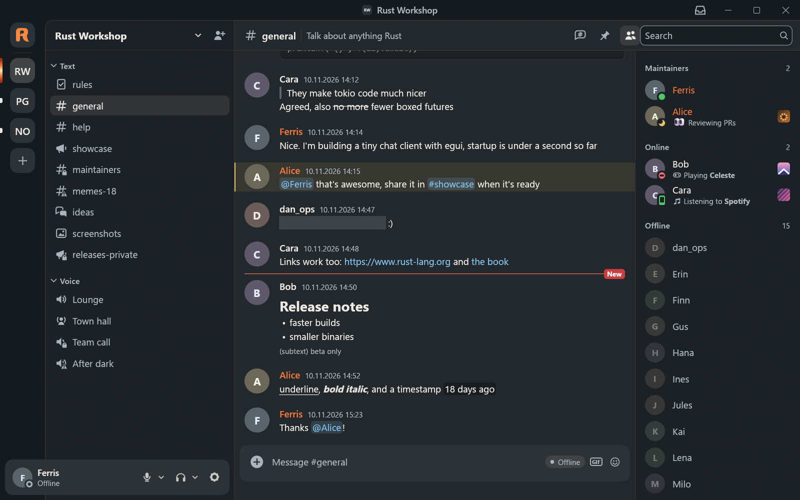
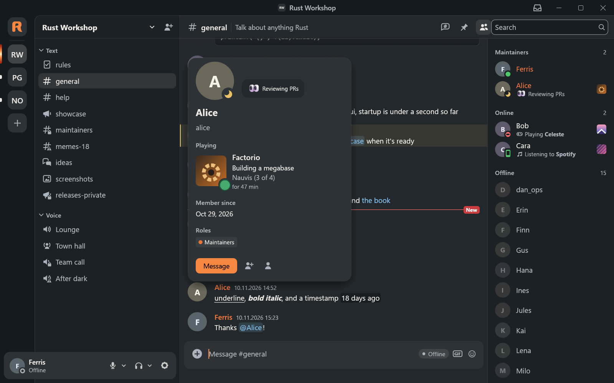
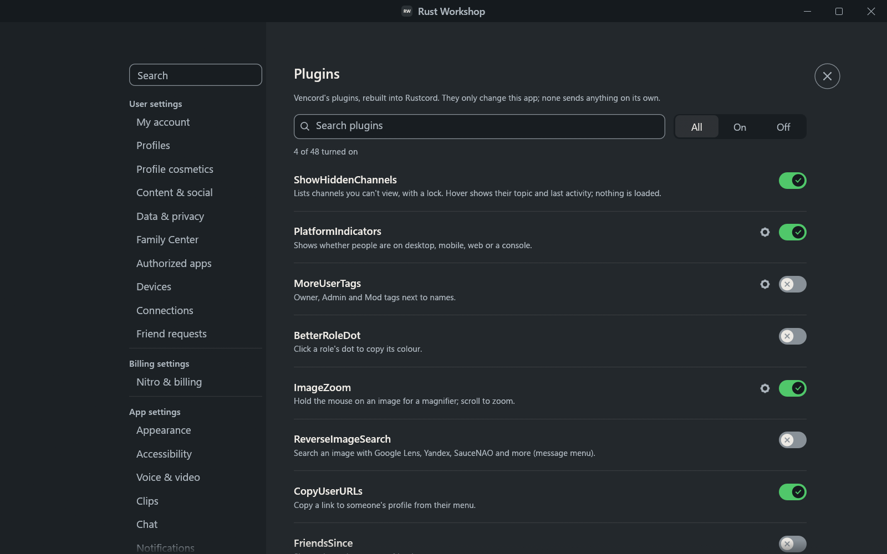

<p align="center">
  
</p>

<h1 align="center">Rustcord</h1>

<p align="center">
  A lightweight, unofficial desktop client for Discord, written from scratch in Rust.<br>
  No Electron, no web view – egui + tokio, talking to the HTTP API and the Gateway directly.
</p>

<p align="center">
  
  
  
</p>

<p align="center">
  
</p>

<table>
  <tr>
    <td></td>
    <td></td>
  </tr>
  <tr>
    <td align="center">Profile card with a game activity</td>
    <td align="center">Settings → Plugins (Vencord-style, built in)</td>
  </tr>
</table>

<sub>Screenshots use the offline demo data from <code>tests/fixtures</code>.</sub>

> **Warning.** Third-party clients that log in with a user account violate Discord's Terms of
> Service and can get the account banned. You use this at your own risk. Rustcord behaves like
> a normal user client (no automation, nothing is sent on your behalf, all rate limits are
> respected), but that does not remove the risk. Rustcord is not affiliated with Discord.

## Features

- Login by QR code, by email/phone + password (with 2FA), or with a pasted token; the
  session token is kept in the OS credential store, logout clears it (see [Logging in](#logging-in)).
- Gateway with heartbeat, zombie detection, resume, reconnect backoff, zlib-stream compression.
- REST rate limiting per bucket + global, honouring `retry_after`.
- Server list with icons, channel list per server, DM list, member list.
- Message history with lazy loading while scrolling up; markdown (bold, italic, underline,
  strike, code, code blocks, links, spoilers, quotes, headings, lists, timestamps), mentions,
  custom and unicode emoji, image/GIF attachments, basic embeds, stickers.
- Send, edit and delete own messages, reply (with or without ping), reactions.
- Unread indicators and mention badges; desktop notifications for mentions and DMs
  (Windows only, also while minimized; no-op on Linux/macOS).
- Disk cache of servers/channels/DMs/recent messages and images: the second start shows the
  cached UI immediately and refreshes in the background.
- Themes (TOML) with a live editor, three built-ins, import/export.
- Local-only profile banner and (animated) avatar – only visible to you, never uploaded.
- Profile cosmetics loaded from Discord: avatar decorations, nameplates, profile effects and
  frames, display-name styles, profile themes, clan tags, badges, connections and games; an
  uploaded banner fades into the profile's background colour.
- Cosmetics editor with Discord's shop catalog: items you own go on your account only via
  "Apply to account"; without (full) Nitro your picks show only in this client, never sent.
- Gradient app themes (the Nitro colour themes), free and only on this device.

- Discord-web layout (own branding): server bar with folders and drag & drop, own title bar
  and window buttons, floating user panel, "new messages" bar, jump to present, message
  context menu.
- Its own look (`docs/DESIGN.md`): steel-blue panes with ember orange only for the brand and
  the main action, one type scale, and Rustcord's own vector icon set drawn in code. Channel
  icons read like Discord's (`#` for text, a speaker for voice, megaphone, forum, media,
  stage, rules) with lock and age-restricted variants; no icon files are copied from Discord.
- Activities like Discord's: games with their art, party size and elapsed time, Spotify with
  album art and a progress bar, streaming, watching; detected games show the game's icon, or
  a controller when there is none. Member list, DMs, friends and profile cards show them.
- Game detection (Windows): every 15 s Rustcord looks at the running programs and matches
  them against Discord's list of detectable games and the games you added in Settings →
  Registered games ("Add it!" picks an open window). Others see your game only while
  Settings → Activity privacy → "Share detected activity" is on (synced with your account,
  like in the official app); your added games stay on this PC.
- Notification-area (tray) icon, close to tray, start when you sign in to Windows, and a
  per-user installer (see [Install](#install)).
- File uploads (button, drag & drop, paste), emoji and GIF pickers, `@ # :` autocomplete,
  typing indicator, online status + custom status, pins, search, mark unread.
- Threads (sidebar rows, thread panel, create), forum/media channels (posts, tags, new post).
- Friends (online/all/pending/blocked, add by username), DMs and group DMs, inbox
  (mentions/unreads), full user profiles with notes.
- User settings with Discord's pages and order, searchable: My Account, Profiles, Content &
  Social, Data & Privacy, Devices, Authorized Apps, Connections, Friend Requests, Appearance,
  Accessibility, Voice & Video, Chat, Notifications, Keybinds, Language, Streamer Mode,
  Advanced, Activity Privacy and more. Synced options are written to your account's settings;
  options whose meaning is unconfirmed are left out. Log Out and other destructive actions ask
  first.
- My Account security: email and phone, Change Password, authenticator app (QR code + key,
  then backup codes) and its removal, SMS backup, View/Generate Backup Codes, security keys
  (rename, remove), the 2FA re-check Discord asks for, Account Standing. Passwords and codes
  are wiped from memory when their dialog closes; a rotated login token replaces the stored
  one. Disable and Delete Account only open discord.com.
- Server administration (channels, categories, roles, permission overwrites, members,
  kick/ban, bans, invites, emoji, notification settings).
- Discord's UI font (gg sans), downloaded at runtime from discord.com into the cache folder
  (never bundled; Settings → Appearance switches it off); otherwise Segoe UI. Decorated
  channel and role names (`・〢┊꒰ᘏ`, 𝐛𝐨𝐥𝐝 letters, box drawing) use the system's fallback fonts
  instead of empty boxes.
- Plugins (Settings → Plugins), rebuilt from Vencord's, all off by default and local to this
  app: AccountPanelServerProfile, BetterFolders, BetterRoleDot, CallTimer, CharacterCounter,
  ClearURLs, CopyUserURLs, CustomIdle, FavoriteEmojiFirst, FriendsSince, GameActivityToggle,
  ImageZoom, IrcColors, MemberCount, MessageLinkEmbeds, MessageLogger (memory only),
  MoreUserTags, MutualGroupDMs, NoBlockedMessages, NoReplyMention, OnePingPerDM, OpenInApp,
  PermissionsViewer, PinDMs, PlatformIndicators, ReadAllNotificationsButton,
  RelationshipNotifier, ReplyTimestamp, ReverseImageSearch, ServerInfo, ShowConnections,
  ShowHiddenChannels, ShowMeYourName, ShowTimeoutDuration, SilentMessageToggle, SilentTyping,
  TextReplace, Translate, TypingIndicator, TypingTweaks, UserVoiceShow, ValidUser, VcNarrator
  (Windows speech), ViewIcons, ViewRaw, VoiceMessages (playback), VolumeBooster (up to 400 %,
  local mix only), WhoReacted. Their options live in `plugins.toml`.
- Voice channels and calls with DAVE end-to-end encryption, camera, screen share (Go Live)
  and watching streams. Camera and screen are only captured after an explicit click.

Not included: other Nitro features, account creation, stickers picker, slash commands/bot
components, solving captchas (when Discord asks for one, do that step in the official app).

## Logging in

The login screen has three tabs:

- **QR code** (default): open the Discord mobile app → Settings → Scan QR Code, scan the
  code and confirm on the phone. Each code lives about two minutes; click *New code* after
  that. Rustcord never retries on its own.
- **Email**: e-mail address or phone number (`+49…`) and password. If the account uses
  two-factor authentication, Rustcord then asks for a code from the authenticator app, an SMS
  code (*Send SMS* first) or one of the backup codes.
- **Token**: paste an account token (the tab explains where to find it).

Limits:

- **Captchas are not supported.** If Discord asks for a captcha (this happens for logins it
  finds unusual), Rustcord stops and says so; use the QR code or token tab, or sign in once
  in the official app. Rustcord never tries to solve or bypass a captcha.
- Accounts whose only 2FA method is a security key/passkey, and Discord's "new login
  location" checks (e-mail link or SMS), need the QR code or one login in the official app.
- Every login attempt is one click. Rate limits are shown ("Wait N s") and never retried
  automatically.

What is stored: only the resulting session token, and only with *Remember on this device*
checked (OS credential store, see below). The password and 2FA code are never written to
disk or logs, are not shown in error messages, and Rustcord wipes its own copies from
memory after sending them. The QR login uses a new RSA key per code that only lives in memory.

## Install

Get `Rustcord-Setup-<version>.exe` from this repository's Releases page once one is
published, or build it yourself (see below). The setup is a single exe built from
Rustcord's own code (about 23 MB with the app inside); no installer tools are involved.

Run it. It installs for your Windows user only (no administrator rights), like Discord: the
app goes to `%LOCALAPPDATA%\Programs\Rustcord`, with a Start menu shortcut, an optional
desktop shortcut and an entry in Settings → Apps. "Open Rustcord when I sign in to Windows"
(on by default) starts it hidden in the notification area. Running the setup again updates
Rustcord in place; a running Rustcord is asked to quit first. `--silent` installs with the
default options without a window.

The setup is not code-signed, so Windows SmartScreen may say "Windows protected your PC".
Select **More info**, then **Run anyway**.

While Rustcord runs, its icon sits in the notification area: click it to open the window,
right-click it for Open Rustcord, Mute, Deafen and Quit Rustcord. Closing the window
(the × in the title bar) only hides it: Rustcord keeps running there, so notifications and
voice keep working. Settings → Windows settings has "Minimize to tray when I close the window"
(turn it off to quit on close), "Open Rustcord when I sign in to Windows" and "Start
minimized". Starting Rustcord again brings the running window to the front;
`rustcord.exe --quit` quits the running one.

To uninstall, use Settings → Apps → Rustcord → Uninstall. "Also delete my local data and sign
out" also removes the settings, the cache and the saved login.

To build the setup yourself (Windows, see Build):

```powershell
powershell -ExecutionPolicy Bypass -File scripts\build-installer.ps1   # -> dist\Rustcord-Setup-<version>.exe
```

## Build

Requirements: Rust stable (1.95+; tested with 1.99); on Windows, the MSVC build tools
(Visual Studio Build Tools with "Desktop development with C++"); on Linux, `pkg-config` and the
OpenSSL development package (e.g. `libssl-dev`).

```bash
cargo build --release
```

The binary is `target/release/rustcord` (`rustcord.exe` on Windows, which embeds
`assets/rustcord.ico` via `build.rs`). Run the tests with:

```bash
cargo test
```

If the project lives in a very deep folder, the MSVC linker can fail with `LNK1104` because
of the 260-character path limit. Build into a short target directory instead:

```powershell
$env:CARGO_TARGET_DIR = 'C:\rc-target'; cargo build --release   # PowerShell
```

```bash
CARGO_TARGET_DIR='C:/rc-target' cargo build --release            # Git Bash
```

The binary is then at `C:\rc-target\release\rustcord.exe`.

To regenerate the icons after editing `assets/logo.svg` / `assets/logo-small.svg` (the same
R-bubble, larger for <= 32 px; `assets/logo-mono.svg` is the flat one-colour mark without the
tile, and `logo_mark` in `src/ui/sidebar.rs` paints the in-app vector copy) (dev-only
dependency `resvg`):

```bash
cargo run --example export_icons
```

## Where things are stored

| What | Windows | Linux | macOS |
|---|---|---|---|
| Config (`settings.toml`) | `%APPDATA%\Rustcord\config\` | `~/.config/rustcord/` | `~/Library/Application Support/Rustcord/` |
| Themes (`*.toml`) | `…\config\themes\` | `…/themes/` | `…/themes/` |
| Local profile overrides | `…\config\overrides\` (`overrides.toml` + image copies) | `…/overrides/` | `…/overrides/` |
| Cache (snapshot, images) | `%LOCALAPPDATA%\Rustcord\cache\` | `~/.cache/rustcord/` | `~/Library/Caches/Rustcord/` |
| Login token | Windows Credential Manager (generic credential `user-token.Rustcord`) | Secret Service | Keychain |
| Added games, saved games list | `…\config\games.json`, `…\cache\detectable.tsv` | – | – |
| Installed app (setup) | `%LOCALAPPDATA%\Programs\Rustcord\` | – | – |
| Start at sign-in | `HKCU\Software\Microsoft\Windows\CurrentVersion\Run`, value `Rustcord` | – | – |

The token is never written to a file or a log. Logging out deletes it from the credential
store and deletes the cache. `RUSTCORD_HOME=<dir>` moves config and cache to `<dir>/config`
and `<dir>/cache` (portable mode).

### settings.toml

Written by the settings page; all keys are optional.

```toml
theme = "Ember Dark"          # built-in name or the name of a theme in the themes folder
desktop_notifications = true
send_read_acks = true         # mark viewed channels read on your account (syncs other devices)
show_member_list = true
animate_others = "hover"      # "always" | "hover" – animated avatars/emoji of others
minimize_to_tray = true       # × hides the window to the notification area (Quit is in the tray menu)
# client_build_number = 0     # optional: sent in the client properties
# system_locale = "en-US"
```

### Themes

Built-in: **Ember Dark** (default), **Paper Light**, **High Contrast**. Create your own in
Settings → Appearance (live preview, *Save as…*, *Import…*, *Export…*) or drop a file into the
themes folder:

```toml
name = "Forest Night"
dark = true

[colors]
background = "#16201b"        # message area
sidebar = "#111915"           # channel / DM list
guild_bar = "#0b110e"         # server icon column
surface = "#1f2b25"           # inputs, embeds, popups
text = "#e3efe7"
text_muted = "#93a89b"
accent = "#5fbf7a"
accent_text = "#08140c"       # text drawn on the accent color
message_hover = "#1b2620"
mention_highlight = "#23402c"
link = "#8fd0ff"
danger = "#ef6b5f"
code_background = "#0f1612"

[font]
ui_font = 'C:\Windows\Fonts\georgia.ttf'   # empty = built-in
mono_font = 'C:\Windows\Fonts\consola.ttf' # empty = built-in
size = 17.0

[layout]
corner_radius = 12.0
compact = false               # true = compact rows without avatars
```

Colors are `#rrggbb` or `#rrggbbaa`. Font paths must be local files.

### Local profile (banner and avatar)

Settings → Local profile: pick any image/GIF as your banner and a GIF, APNG or animated WebP
(or a still image) as your avatar. They replace your banner/avatar everywhere in this client
(messages, member list, profile card, user panel) and are only visible to you on this device.
"Only on hover" animation keeps idle CPU at zero. Each override has its own *Reset* button.

## Performance (release build, offline with cached data for 3 servers + DMs)

| Phase | Window visible | First frame (cached UI) | RAM (working set) | Idle CPU |
|---|---|---|---|---|
| 1 – core | 44 ms | 163 ms | 94.5 MB | 0 % |
| 2 – customization | 45 ms | 154 ms | 94.6 MB (104 MB with animated avatar + banner) | 0 % (7 % of one core with an always-animating avatar) |
| 3 – logo & polish | 30 ms (466 ms on the first, cold run) | 155 ms | 95.6 MB (103.6 MB with animated avatar + banner) | 0 % |
| 4 – installer, tray, activities & new look | 161 ms (GL context ready) | 174 ms | 102.3 MB (87.6 MB private) | 0 % (game detection: ~16 ms CPU per 15 s scan) |

Measured on a Ryzen 7 5825U, Windows 11, median of 5 runs. These runs had no network images
loaded; with a live connection, avatars and attachments add to RAM (textures are capped at a
12 MB budget and evicted when unused).

## Developer notes

- `docs/ARCHITECTURE.md` – module layout (`gateway/`, `api/`, `cache/`, `ui/`, `theme/`,
  `assets/`), data flow, rules, test hooks (`RUSTCORD_OFFLINE`, `RUSTCORD_SCREENSHOT`, …).
- `docs/PROTOCOL_NOTES.md` – the user-API protocol details the client implements.
- `docs/AUTH_NOTES.md` – password/2FA login and QR login (remote auth v2) protocol.
- `docs/EGUI_0_37_NOTES.md` – egui 0.37 API notes.
- `docs/FEATURES_NOTES.md` – endpoints/events for chat, social, account & server features.
- `docs/VOICE_NOTES.md`, `docs/VOICE_DESIGN.md`, `docs/VIDEO_DESIGN.md` – voice/video
  protocol (incl. DAVE) and the `src/voice/` engine.
- `docs/CHAT_ESSENTIALS_DESIGN.md`, `docs/SOCIAL_DESIGN.md`, `docs/ACCOUNT_SERVER_DESIGN.md`,
  `docs/SOCIAL_UI_DESIGN.md` – backend contracts and UI hook-up per feature block.

## License

MIT, see [LICENSE](LICENSE).

The Rustcord logo (`assets/`) is original to this project and does not use Discord's logo,
wordmark or brand colors. Discord's UI font (gg sans) is not part of this repository; it is
only downloaded at runtime.
